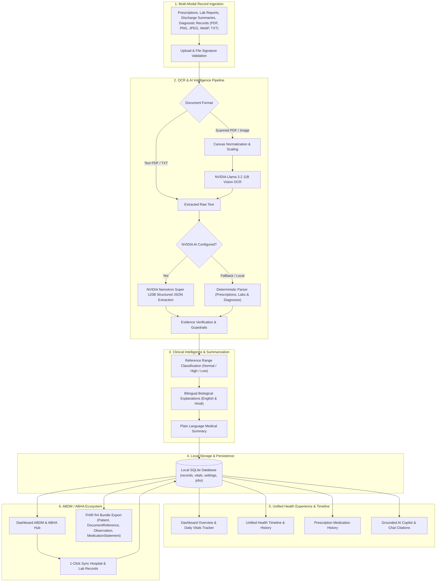
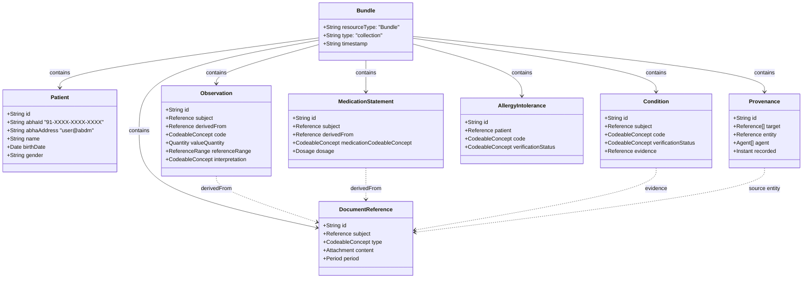

# Sehat architecture

Sehat keeps extracted facts, source snippets, processing provenance, and review status together. The interface reads the same domain records used for timeline views, chat context, and FHIR export.

## Components and interfaces

| Layer | Files | Responsibility |
| --- | --- | --- |
| Product UI | `src/App.tsx`, `src/components`, `src/pages` | Navigation, consent upload, review/edit, language, timeline, chat and profile |
| API client | `src/api.ts` | Typed JSON and multipart requests |
| HTTP service | `server/index.mjs` | Loopback requests, route validation, jobs, review, safe chat boundary and export |
| Document pipeline | `server/pipeline.mjs` | Signature validation, PDF text, page/image rendering, orchestration and local lab parser |
| Inference client | `server/nim.mjs` | Server-only credential, model routing, timeout, structured response parsing and provider errors |
| Grounded chat | `server/chat.mjs` | Saved fact catalog, relevance selection validation, deterministic answer and citations |
| Domain boundary | `server/domain.mjs` | Bounded normalization, evidence checks, missingness, range flags and bilingual templates |
| Persistence | `server/store.mjs` | SQLite records, profile and upload jobs |
| Exchange | `server/fhir.mjs` | Linked FHIR R4-style collection |
| Shared model | `shared/types.ts`, `shared/demo.mjs` | Application contract and synthetic fixtures |

The canonical record has its own ID, document date (or `null`), provider, filename, source text, localized summary/key points, observations, medications, explicitly recorded diagnoses, review status, demo flag, creation timestamp, and provenance. An observation carries its number or `null`, unit, report-provided reference limits or `null`, source snippet, and explanation.

## Processing and persistence

`POST /api/records` accepts a single multipart file only with `consent=true`. It validates file content and immediately returns a persisted job. Processing updates the job stage. A successful result persists a new pending record and records its ID on the completed job. Failures persist a failed job with a user-readable error. On restart, queued/processing jobs become failed with a retry explanation.

Text PDFs use embedded text. Pages with little usable text are rendered before OCR, with a bounded number of scanned pages. Images are decoded and resized to at most 1800 pixels on their longest side before inference. PDF pages remain in source order. Provider calls have a 90-second timeout per call and reject empty, unreadable, or token-truncated output.

Raw upload bytes live in memory for the job and are released afterward. The database stores extracted source text, normalized fields, provenance, and profile data. Original files do not have public download routes. The user should retain the original document because OCR text alone is insufficient to verify a difficult scan. SQLite uses a local WAL journal and parameterized statements. Deleting a record removes it from the application store; this is not a certified secure-erasure mechanism.

## Model routing

| Stage | Default hosted model |
| --- | --- |
| Image/page transcription | `meta/llama-3.2-11b-vision-instruct` |
| Structured extraction | `nvidia/nemotron-3-super-120b-a12b` |
| English chat fact selection | `nvidia/nemotron-3.5-lightning-30b-a3b` |
| Hindi chat fact selection | `nvidia/nemotron-3-super-120b-a12b` |

English/Hindi record summaries and result explanations come from deterministic templates after normalization. Chat builds a bounded catalog of those facts with short IDs such as `F1`. The hosted model returns up to six relevant IDs; the server validates them, renders the existing fact text, and derives citations from each fact's source record. It does not display free-form model medical prose. An empty selection with `insufficientEvidence: true` produces a clear missing-information response. This keeps relevance selection useful while restricting the answer to saved evidence.

These language paths do not imply that the OCR model has validated Hindi or handwriting performance. The source research contains successful printed-English OCR and separate text-language smoke tests. See [integration evidence](research.md) for the exact scope.

The inference client reads `NVIDIA_API_KEY` from the server environment. The browser receives configuration state and model IDs, never the key. With AI configured, consenting to upload permits the external inference request. Sending a chat question sends selected saved-record context to the hosted model.

## Domain and safety boundaries

- Only recognized fields enter a normalized record. Model-provided IDs, review status, demo flags, summaries, and provenance do not override pipeline metadata.
- Clinical snippets must appear in source text. Observation names and units must have supporting text. Numeric results must match a reported result after the analyte name. Missing, nonfinite, qualified, or unsupported numeric values stay `null`.
- Ranges come from the document. A two-sided valid range supports `low`, `normal`, or `high`; otherwise the comparison is `unknown`. An out-of-range flag does not generate a diagnosis.
- Medication names and written instruction fields require supporting snippets. A past prescription does not establish current medication use or adherence.
- Review corrections preserve the original extracted source and add a provenance warning. The reviewer can correct OCR errors, including numbers, and the API recalculates flags and explanations. “Reviewed” describes source review, not medical attestation.
- Chat checks common emergency, diagnosis, and dosage-change requests before inference. The hosted model selects only catalog fact IDs. Unknown IDs, malformed selections, or provider errors trigger a local summary; accepted selections render existing fact text and its source citations. Pattern checks, extraction quality, and relevance selection still have limits and require clinical evaluation before real use.

The initial upload limit is 12 MB, eight total PDF pages, four OCR pages, 28,000 source characters, 40 megapixels, two concurrent upload jobs, and 250 saved records. Normalization additionally bounds clinical arrays and strings. This limits processing scope but is not a production abuse-prevention system.

## Failure behavior

| Situation | Observable result |
| --- | --- |
| No credential, supported text laboratory report | Limited local parser, `mode: local`, provenance warning |
| No credential, image or scanned PDF | Clear OCR configuration error |
| Configured upload provider fails | Failed upload job; no synthetic result substituted |
| Configured chat provider fails / unusable output | Local summary with `mode: local` and explanatory text |
| Source date missing or ambiguous | `date: null`, displayed as unknown; upload time remains distinct |
| Missing/unverified value or range | Blank numeric field or unknown comparison, with review context |
| Server restart during processing | Failed job with explicit re-upload message |

## FHIR and ABHA scope

### ABDM-Ready FHIR Data Schema

The exporter returns a `Bundle` of type `collection`. Entries use unique `urn:uuid:` full URLs, and all internal resource references resolve within that collection. It includes `Patient` (with 14-digit ABHA ID and ABHA address), patient-reported `AllergyIntolerance`, `DocumentReference`, `Observation`, `MedicationStatement`, explicit-source `Condition`, and `Provenance` resources as applicable. Document references embed the extracted source text. Observations and medication statements link back to those documents. Missing observation numbers use `dataAbsentReason`, not a fabricated zero. Medication use remains `unknown`, and clinical diagnoses remain unconfirmed transcriptions.

This is a FHIR R4-style prototype aligned with ABDM standards. It supports simulated ABHA linking, ABDM health information record imports, and complete FHIR bundle export. Future production interoperability requires national ABDM gateway certification and controlled SNOMED CT / LOINC terminology validation.

## Deployment boundary

The service binds to loopback, validates localhost hosts/origins, and does not enable general CORS. The design remains a single-user local prototype without authentication, database encryption, role-based access, or a production privacy/security guarantee. A hosted deployment needs those controls, data retention rules, operational monitoring, and expert evaluation before handling real clinical information.
